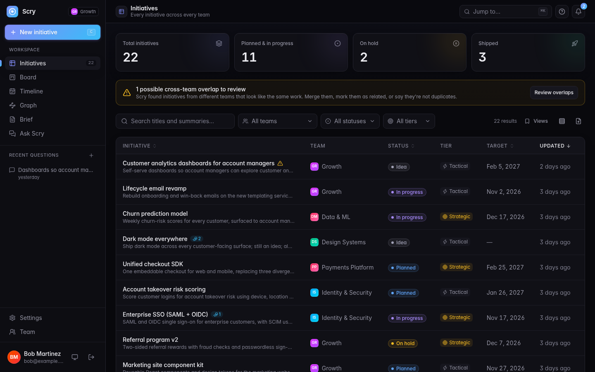
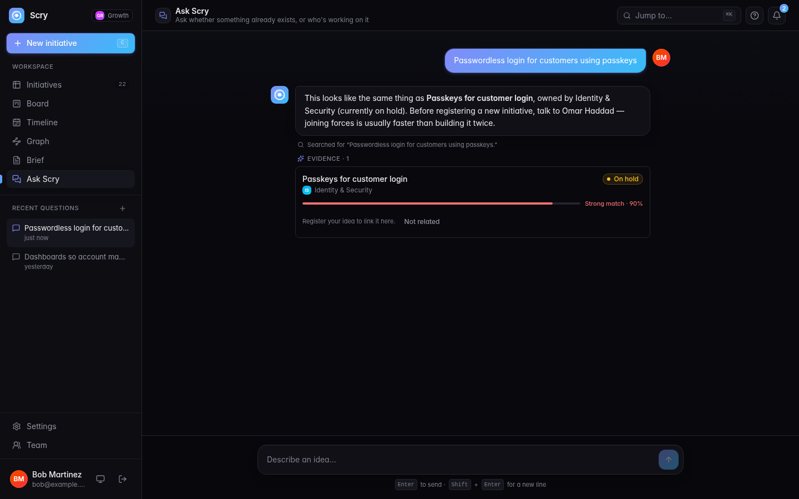
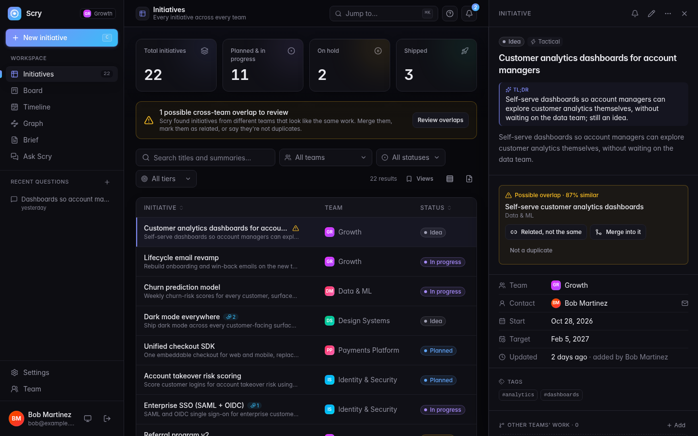
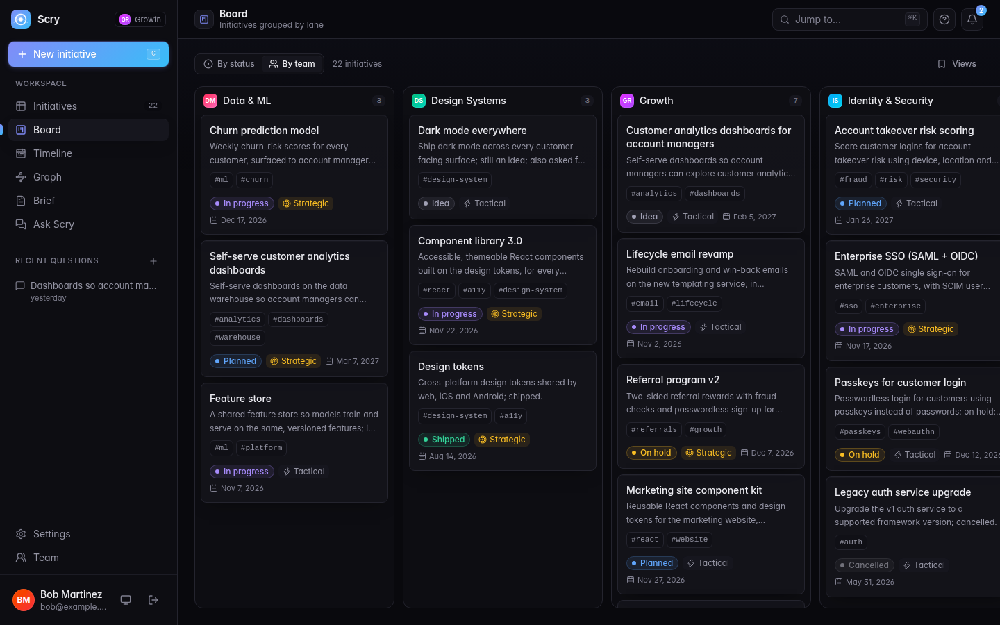
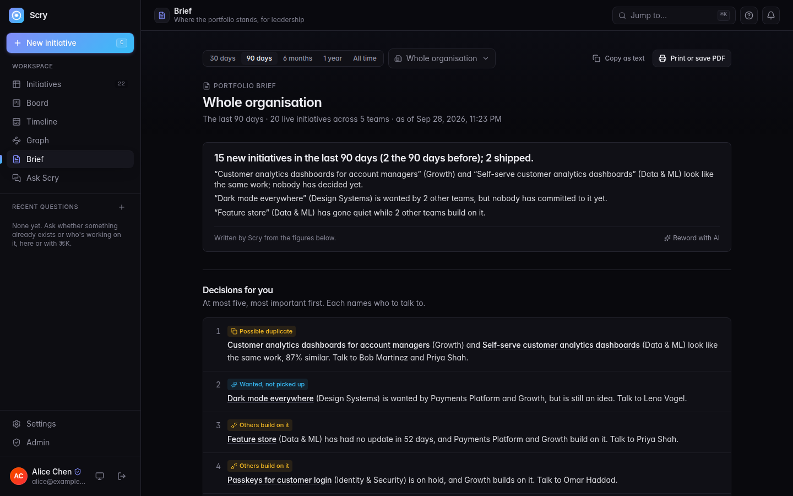

# Scry

Scry is a shared register of what every team is building or planning, so
people find related work before they start and two teams don't build the
same thing.




Teams record their initiatives (ideas, plans and work in progress) in one
place. Scry compares them by meaning, points out likely duplicates between
teams, shows which teams build on each other's work and what several teams
want, and answers "is anyone already doing this?" before new work starts.
It isn't a delivery tracker: no tasks, estimates or dependency chains.

It is self-hosted, signs people in with your identity provider (OIDC), and
works with any OpenAI-compatible AI endpoint, or without AI at all.

## Features

- **Ask before you build.** Describe an idea and Scry tells you whether it
  exists already, which team owns it and who to talk to.
- **New initiatives checked as you type.** The form shows similar work from
  other teams, and AI can draft the fields from a rough description.
- **Duplicates flagged across teams**, with "related, not the same", merge
  (the other team accepts it) and "not a duplicate" options.
- **Connections and demand.** Relationships between teams ("builds on",
  "replaces", "related") and "we need this too", with a reason, show who
  should talk to whom and which work several teams want.
- **A one-line TL;DR** on every initiative, kept up to date as its status and
  relationships change.
- **Table, board, timeline and graph views**, saved views and shareable
  links. The graph maps the whole organisation by team and opens teams as
  you zoom in.
- **A portfolio brief** for leadership: what needs a decision, the most
  wanted work, emerging themes and what changed, on one printable page.
- **Notifications**, follows, comments and a full history per initiative.
- **Ask Scry from your AI tools.** A read-only MCP server for Claude, Cursor,
  VS Code and other assistants: people sign in as themselves, admins switch
  it on and see every call.
- **A short guided tour** for first-time users, available again from Help.
- **Teams that run themselves.** People ask to join a team and its team
  admins let them in; an admin approves new teams. Org units and countries
  come from a configured list.
- **Admin tools:** AI settings in the browser, people and teams, AI tool
  access, CSV and Jira import, and an audit log.

| Ask Scry                                                       | Overlap between two teams                                               |
| -------------------------------------------------------------- | ----------------------------------------------------------------------- |
|  |  |

| Board                                                | Portfolio brief                                    |
| ---------------------------------------------------- | -------------------------------------------------- |
|  |  |

The **[user guide](docs/user-guide.html)** walks through each feature, and
the **[architecture](docs/architecture.md)** shows how Scry is built: context,
deployment, api modules, data model and the main request flows.

## Try the demo

You need Docker. This runs Scry with a sample company, a local Keycloak for
sign-in and an offline stand-in for the AI, so no accounts or API keys are
needed:

```bash
cp .env.keycloak.example .env
docker compose -f infra/docker/docker-compose.prod.yml \
               -f infra/docker/docker-compose.keycloak.yml \
               -f infra/docker/docker-compose.demo.yml up -d --build
```

1. Open http://localhost:3000 and sign in as `alice` / `alice123` (admin).
2. Click **Set up AI**, choose **Demo LLM**, then **Test connection** and
   **Save**.
3. Sign in as anyone else: `bob`, `sam`, `dan`, `priya`, `lena`, `omar` or
   `carol`. Each password is the name followed by `123`.

[docs/demo.md](docs/demo.md) describes the sample company and a guided tour.

## Deploy

### Docker Compose

```bash
cp .env.example .env   # set SESSION_SECRET and the OIDC_* values
docker compose -f infra/docker/docker-compose.prod.yml up -d --build
```

This starts Postgres 18 (with pgvector), Valkey (Redis-compatible), the API
and the web app, and applies database migrations. The web app is on port 3000 and
the API on 3001 (`/health`, API docs at `/docs`).

`NEXT_PUBLIC_API_URL` is built into the web app, so set it in `.env` before
building if the API isn't at `http://localhost:3001`.

For a real pilot (HTTPS, first admins, backups and restores, upgrades),
follow [docs/pilot.md](docs/pilot.md).

### Kubernetes

A Helm chart is in `infra/helm/scry`. Build `apps/api/Dockerfile` and
`apps/web/Dockerfile`, push them to your registry (Postgres is the stock
`pgvector/pgvector:0.8.6-pg18` image; a managed Postgres needs pgvector 0.8
or later and `pg_trgm`), then:

```bash
helm install scry infra/helm/scry \
  --set image.registry=ghcr.io/your-org \
  -f my-values.yaml
```

`infra/helm/scry/values.yaml` lists the options: ingress, bundled or
external Postgres and Valkey (any Redis-compatible server works), secrets
and resources.

## Configuration

### Sign-in

Any OIDC provider (Keycloak, Entra ID, Okta, Google Workspace…). Set
`OIDC_ISSUER_URL`, `OIDC_CLIENT_ID`, `OIDC_CLIENT_SECRET` and
`OIDC_REDIRECT_URI` (`<api url>/auth/callback`). Scripts use a personal
access token from **Settings → API tokens**; AI assistants connect through
the read-only MCP server (see the user guide).

Set `INITIAL_ADMIN_EMAILS` before anyone signs in: those people become
admins on their first sign-in, and nobody else does. Admins then approve
new teams, and each team's admins let people in. Teams are filed under the
org units and countries listed in `ORG_UNITS` and `COUNTRIES`.

### AI

An admin connects AI in **Admin → AI & models**; no restart is needed. Scry
works with any OpenAI-compatible endpoint: a LiteLLM gateway, OpenAI, Azure
OpenAI, vLLM or Ollama. It can authenticate with an API key, with OAuth2
client credentials from your identity provider, or with short-lived JWTs it
signs itself (public keys at `/.well-known/jwks.json`).

There is one model per job: embeddings (search and duplicate detection),
the assistant (Ask Scry) and tasks (drafting, TL;DRs, summaries).
**Test connection** checks each one, and a usage panel shows calls, errors,
latency and tokens.

- Credentials are stored encrypted (`SETTINGS_ENCRYPTION_KEY`, or derived
  from `SESSION_SECRET`).
- `LLM_ALLOWED_HOSTS` restricts which hosts AI traffic may go to.
- The `LLM_*` variables are used until an admin saves settings in the app.
- `docker-compose.litellm.yml` adds a local LiteLLM gateway
  (`infra/docker/litellm.config.yaml`).

Without AI, Scry still works; Ask Scry, duplicate detection, TL;DRs and the
writing help are turned off.

### AI tools (MCP)

An admin turns on **Admin → AI tools**; people then add
`<api url>/mcp` to Claude, Cursor, VS Code or another MCP client and sign
in through Scry (OAuth 2.1, read only). Set `API_PUBLIC_URL` if the api's
public address isn't `NEXT_PUBLIC_API_URL`; `MCP_LOG_RETENTION_DAYS`
(default 90) sets how long each call is kept.

### Notifications

Everyone has an in-app inbox. For more:

- `NOTIFICATIONS_ALERTS=true` with `NOTIFICATIONS_WEBHOOK_URL` posts events
  to a Slack- or Matrix-compatible webhook as they happen.
- `NOTIFICATIONS_CHANNEL=webhook` or `email` (with `SMTP_*` and
  `NOTIFICATIONS_EMAIL_TO`) sends a weekly digest; `NOTIFICATIONS_CRON` sets
  when (default Monday 09:00).

`.env.example` lists every setting.

## Development

Requires Node.js 24, pnpm 12 (`corepack enable`) and Docker.

```bash
cp .env.example .env
pnpm install
docker compose -f infra/docker/docker-compose.yml up -d   # Postgres + Valkey
pnpm --filter @scry/db db:migrate
pnpm --filter @scry/db db:seed                            # sample data
pnpm dev                                                  # web :3000, API :3001
```

```bash
pnpm lint && pnpm typecheck && pnpm test   # checks and unit tests
pnpm test:e2e                              # API and browser tests (wipes the database)
```

The code is a pnpm monorepo: `apps/api` (NestJS), `apps/web` (Next.js),
`packages/db` (Drizzle schema and migrations) and
`packages/shared` (types).

## Contributing

See [CONTRIBUTING.md](CONTRIBUTING.md). To report a security problem, see
[SECURITY.md](SECURITY.md).

## License

Apache License 2.0; see [LICENSE](LICENSE) and [NOTICE](NOTICE).
