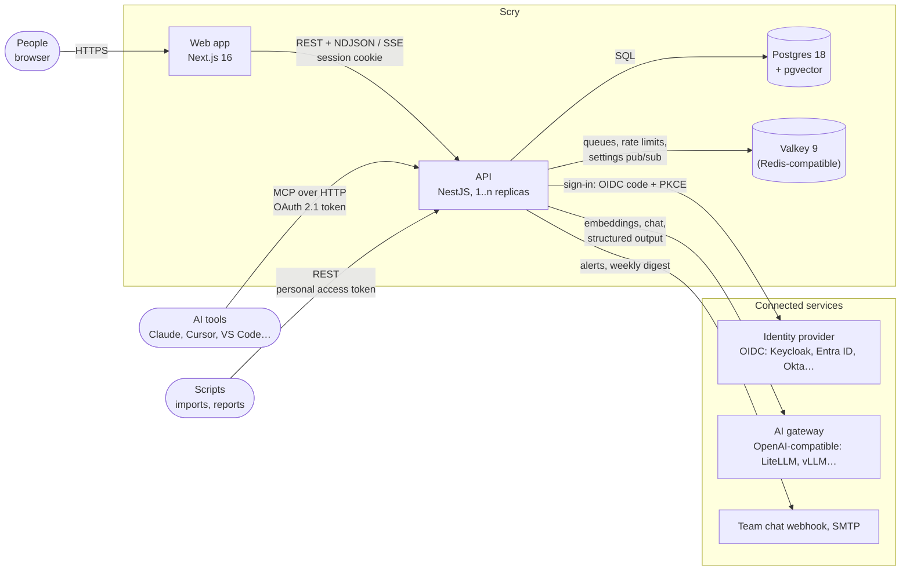
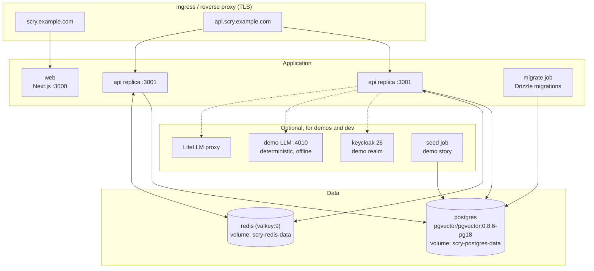
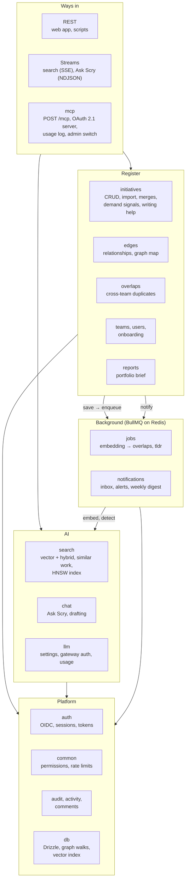
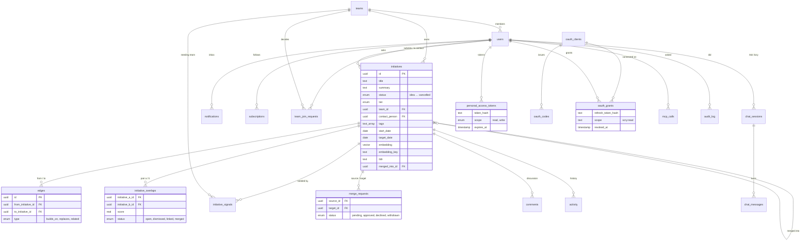
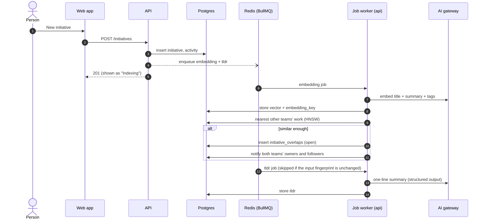
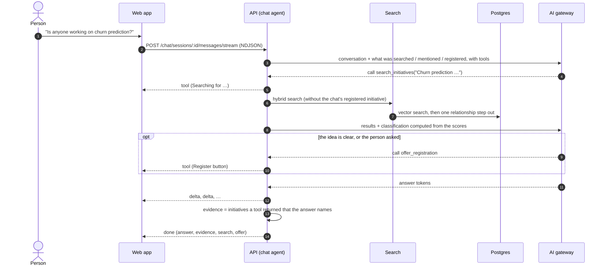
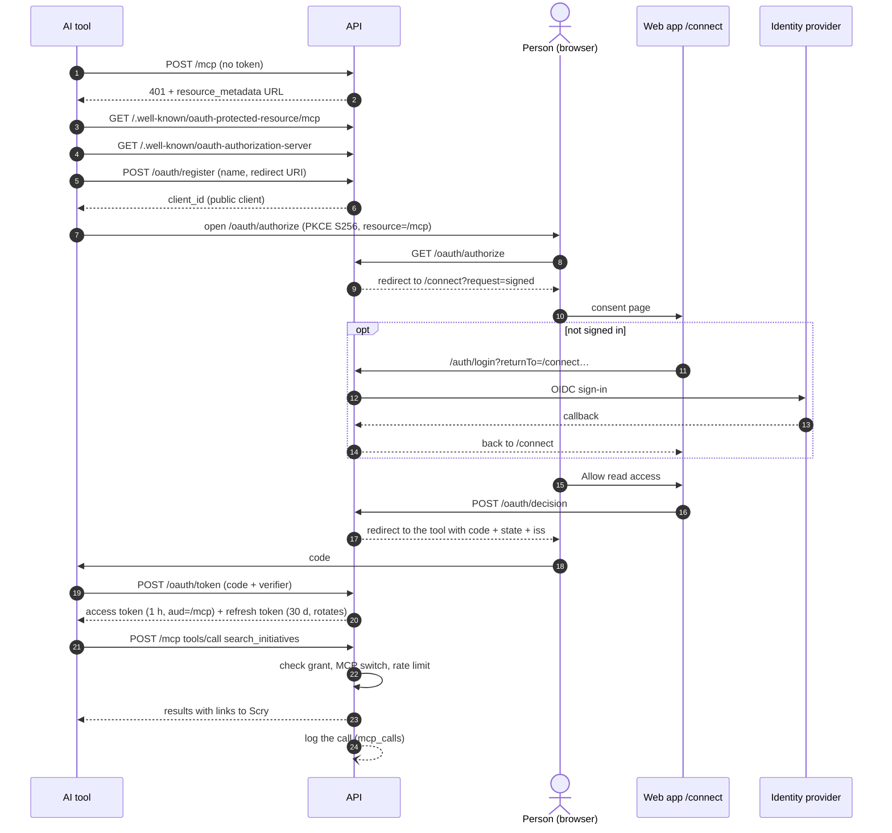
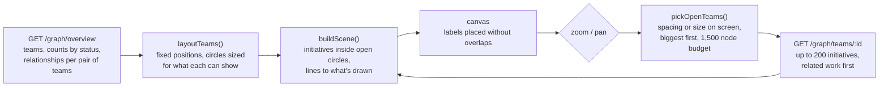

# Scry architecture

How Scry is built: what it talks to, how it's deployed, what's inside the
api, where data lives, and how the main requests flow. Diagrams are
[Mermaid](https://mermaid.js.org/) and render on GitHub; edit them as text.

## 1. Context

Scry is two apps (web and api) in front of Postgres and Valkey (a
Redis-compatible store; "Redis" below means either). People sign
in through the company's identity provider. AI features call any
OpenAI-compatible endpoint the admin connects, and everything still works
without one.

| Talks to Scry | How                              | Credential                                                                   |
| ------------- | -------------------------------- | ---------------------------------------------------------------------------- |
| People        | The web app, which calls the api | Session cookie (HS256 JWT, 7 days) after OIDC sign-in                        |
| AI tools      | `POST /mcp` (read-only)          | OAuth 2.1 access token bound to `/mcp`, or a read-only personal access token |
| Scripts       | REST (`/docs` has the OpenAPI)   | Personal access token, read or write                                         |

| Scry talks to      | Why                                                                      | Without it                                                    |
| ------------------ | ------------------------------------------------------------------------ | ------------------------------------------------------------- |
| Identity provider  | Sign-in (Authorization Code + PKCE)                                      | Nobody can sign in                                            |
| AI gateway         | Embeddings (search, duplicates), Ask Scry, drafts, TL;DRs, brief wording | Everything else works; AI features hide or explain themselves |
| Chat webhook, SMTP | Real-time alerts (opt-in) and the weekly digest                          | Only the in-app inbox                                         |

## 2. Deployment

The same images run under Docker Compose and the Helm chart. The api is
stateless (sessions are signed cookies, jobs and settings changes go through
Redis), so it scales out; a migrate job runs before it starts.

- `NEXT_PUBLIC_API_URL` is baked into the web build; the browser calls the api
  directly (CORS allows `WEB_ORIGIN`, with credentials).
- The HNSW vector index is built by the api (on boot, and when the embedding
  size changes), not by a migration.
- Backups: `infra/docker/backup.sh` (Postgres dump); Redis holds only queues
  and caches.

## 3. Inside the api

NestJS modules, grouped by job. Controllers are thin; the rules live in
services, and the pure parts (prompts, layout, protocol, permissions) are
unit-tested functions.

| Module          | Owns                                                                | Notes                                                                                |
| --------------- | ------------------------------------------------------------------- | ------------------------------------------------------------------------------------ |
| `auth`          | Sign-in, session cookies, personal access tokens                    | Read tokens can only `GET`; OIDC `returnTo` only accepts app paths                   |
| `initiatives`   | Initiatives, import, merge (and merge requests), "we need this too" | Merges only a flagged duplicate; the target's owners accept unless you can edit both |
| `edges`         | Relationships between teams; the graph's team map                   | Walks at most 2 steps with a recursive CTE                                           |
| `overlaps`      | Likely duplicates across teams                                      | Found after embedding; settled by related / merge / not a duplicate                  |
| `search`        | Vector and hybrid search, similar work                              | Only compares vectors with the current `embedding_key`                               |
| `chat`          | Ask Scry (an agent with search, look-up and register tools)         | Tools keep the rules; evidence only from what tools returned                         |
| `reports`       | The brief                                                           | Every figure computed in SQL; AI may only reword                                     |
| `llm`           | AI settings (secrets encrypted), gateway auth, usage                | Changes broadcast to every replica over Redis                                        |
| `jobs`          | Embedding and TL;DR queues                                          | Backfill on boot and when AI settings change                                         |
| `notifications` | Inbox, follows, alerts, weekly digest                               | Best effort: never fails the action that caused it                                   |
| `mcp`           | MCP endpoint, OAuth 2.1 server, usage log                           | Off until an admin turns it on                                                       |

## 4. Data model

The main tables and how they connect. Initiatives carry their embedding
(an untyped `vector`, compared only within one `embedding_key`).

Also: `llm_settings` (one row; secrets AES-256-GCM encrypted), `llm_calls`
(30 days), `app_settings` (the MCP switch), `mcp_calls` (90 days by default).

## 5. Flows

### 5.1 A new initiative is indexed and checked for duplicates

Writes return at once; indexing is background work. Queue `add()` is never
awaited on a request path, so Redis being down never blocks a save.

### 5.2 Ask Scry

An agent: the model decides which tools to call; the tools run in Scry, as
the person, and keep the rules (match strength from scores, no registering
before a search or twice).

### 5.3 Connecting an AI tool (MCP)

Read-only, always as a person. The tool discovers Scry's OAuth server,
registers itself, and the person approves it on Scry's consent page.

### 5.4 The Graph's team map

The browser never loads the whole register. It gets one circle per team,
then opens teams as they get big enough on screen, within a node budget.

## 6. Credentials at a glance

| Credential                    | Issued by                   | Lifetime                 | Accepted by         | Can write            |
| ----------------------------- | --------------------------- | ------------------------ | ------------------- | -------------------- |
| Session cookie                | `/auth/callback` after OIDC | 7 days                   | Every REST endpoint | Yes, per permissions |
| Personal access token (read)  | Settings → API tokens       | Chosen, or never expires | REST `GET`, `/mcp`  | No                   |
| Personal access token (write) | Settings → API tokens       | Chosen, or never expires | REST, `/mcp`        | Yes, per permissions |
| MCP access token              | `/oauth/token`              | 1 hour                   | `/mcp` only         | No                   |
| MCP refresh token             | `/oauth/token`              | 30 days, rotates on use  | `/oauth/token`      | No                   |

Permissions (who may edit, relate or merge) live in
`apps/api/src/common/permissions.ts` and are mirrored in
`apps/web/src/lib/permissions.ts`. Session and MCP tokens are signed with
keys derived from `SESSION_SECRET` per purpose, so one can never pass as
the other.
